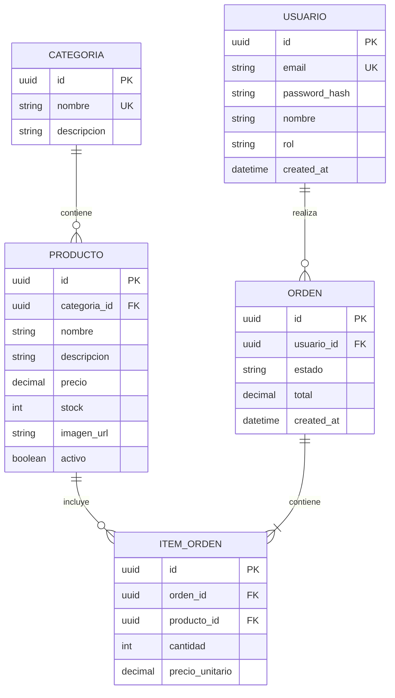

# Diagramas del Sistema

Esta carpeta contiene los diagramas arquitectónicos, modelos de datos y flujos de negocio del proyecto de **E-commerce**.

---

## 1. Diagrama de Arquitectura General (C4 - Nivel 2: Contenedores)

```mermaid
graph TD
    Client["Cliente / Usuario Web\n(Navegador)"]
    Frontend["Frontend App\n[React + TypeScript + Vite]\nPuerto 5173"]
    Backend["Backend API REST\n[NestJS + TypeScript]\nPuerto 3000"]
    Database[("Base de Datos\n[PostgreSQL]\nPuerto 5432")]

    Client -->|HTTPS / UI| Frontend
    Frontend -->|HTTP / REST API (JSON)| Backend
    Backend -->|TypeORM / Prisma (TCP)| Database
```

---

## 2. Diagrama de Entidad-Relación Inicial (E-commerce Core)



---

## 3. Convenciones para nuevos diagramas

* Se recomienda utilizar sintaxis **Mermaid** incrustada directamente en archivos Markdown para mantener versionado junto al código.
* Para diagramas de diseño visual exportados (PNG, SVG, Draw.io), guardarlos en esta carpeta con un nombre descriptivo (ej: `diagrama-flujo-checkout.svg`).
