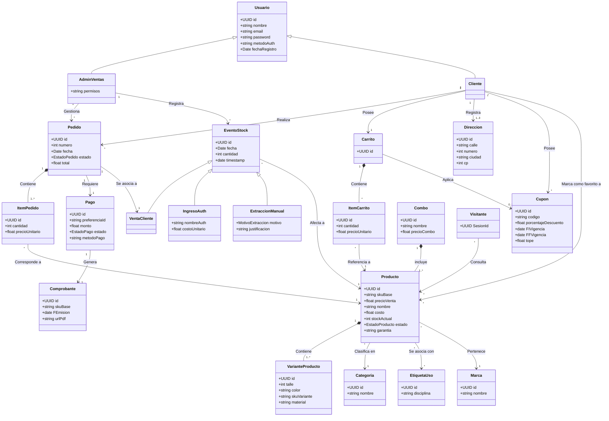

# Diagrama de Clases del Dominio (E-Commerce)

Este diagrama representa la estructura de clases del modelo de dominio del sistema, sus atributos, operaciones, jerarquías de herencia y multiplicidades.

---

## 1. Código Mermaid

---

## 2. Análisis del Diagrama (Evaluación Crítica de Arquitectura)

Al contrastar este diagrama de clases con las buenas prácticas de arquitectura y las reglas de negocio de un E-Commerce con libro mayor inmutable, se identifican las siguientes observaciones:

### 1. `EventoStock` vs. `StockMovement` (Muy Bien Modelado)
* **Acierto:** Modelar los movimientos como una jerarquía polimórfica (`EventoStock` especializado en `VentaCliente`, `IngresoAuth` y `ExtraccionManual`) coincide conceptualmente con el patrón de **Libro Mayor (Append-Only Ledger)** requerido para auditoría.
* **Detalle a mejorar (Variantes vs. Producto Base):** En el diagrama, `EventoStock` apunta a `Producto`. No obstante, el stock físico en tiendas de indumentaria/calzado no existe en el producto abstracto, sino en la **`VarianteProducto`** (un talle o color específico). Es altamente recomendable que `EventoStock` afecte directamente a `VarianteProducto`.

### 2. Atributo `stockActual: int` en `Producto`
* **Observación crítica:** Si se prohíben las mutaciones directas sobre el inventario, `stockActual` **no debe ser un campo editable**. En su lugar, debe ser un valor calculado a partir de la suma de `EventoStock` (o una propiedad getter / vista materializada). Además, debería residir a nivel de `VarianteProducto` (el producto base sólo tendría la suma total).

### 3. Asociación de `ItemPedido` e `ItemCarrito`
* En el diagrama, ambos apuntan a `Producto`. Al existir `VarianteProducto` (con talle y color), cuando el cliente agrega un producto al carrito o realiza un pedido, debe seleccionar una **`VarianteProducto`** puntual para saber qué talle/color empaquetar y descontar del inventario.

### 4. Fortalezas Notables
* **Herencia de `Usuario`:** La separación de roles entre `Cliente` y `AdminVentas` permite modelar permisos y comportamientos especializados sin redundancia.
* **Regla de negocio `Direccion`:** La restricción `1..3` direcciones por cliente está explícitamente plasmada.
* **Ciclo de Orden y Pago:** El desacoplamiento entre `Pedido`, `Pago` y `Comprobante` permite soportar múltiples pasarelas (MercadoPago, Stripe) y estados asíncronos (`EstadoPago`).
* **Concepto de `Visitante`:** Permite carritos anónimos y métricas de interés antes del login.
